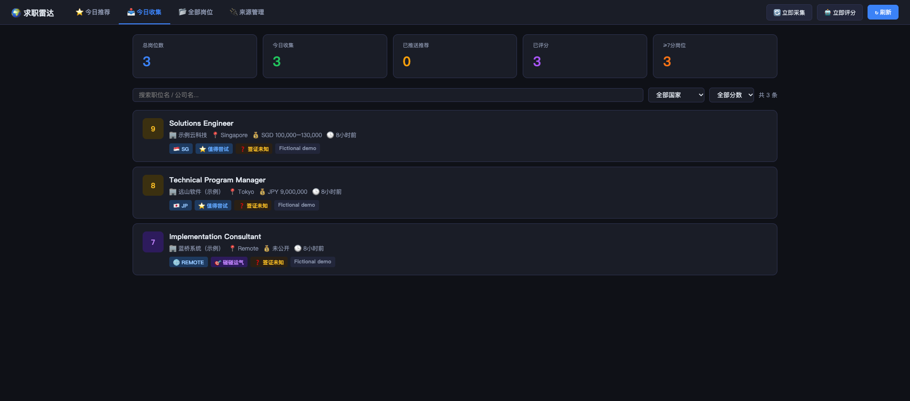
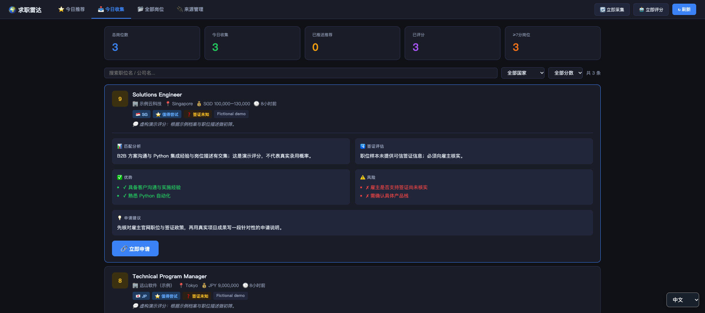
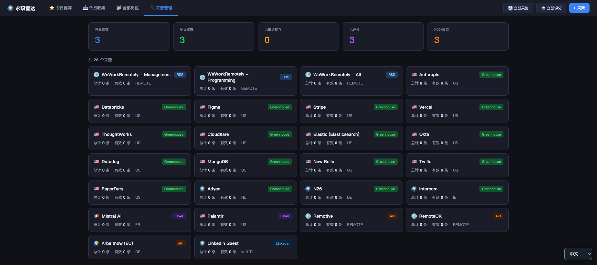

# Job Radar

**Language:** [简体中文](README.md) · English · [日本語](README.ja.md)

**Spend less time revisiting job boards and more time applying to the right roles.** Bring listings into one view, compare them with your own preferences, and see the match reasons and missing facts—especially visa and salary—before investing time in an application.

> **Enterprise AI consulting & development** (Feishu/Lark integration, private deployment, custom builds) → [buildwithneo.cn](https://buildwithneo.cn/)

### From listing to decision · synthetic candidate and jobs

**Three jobs in one view:**

**Match, risks, and next step:**

**Configured sources:**

The sample scores and analysis are hand-written demonstration data, not a live AI result. Source counts are zero because the demo does not contact job platforms.

Aggregate public job listings, filter them using configurable role, region, visa, and salary preferences, and optionally analyze matches with OpenRouter. The site binds to localhost by default.

## Try the demo

Use Python 3.11+. Run `pip install -r requirements.txt`, then `python scripts/seed_demo.py` and `python api/app.py`. Open `http://127.0.0.1:8077`. The sample candidate “Lin Zhiyao” and all three jobs are fictional; the demo does not contact job sites, models, or Feishu.

## Configure your own search

Copy `.env.example` to `.env`. Copy `config/profile.example.json` to `config/profile.json`, edit it, and set `JOB_RADAR_PROFILE=config/profile.json`. Update `config/sources.yaml` for your keywords, salary threshold, and sources. `python scripts/collect_once.py` collects once; `python run_full.py` scores, analyzes, and optionally delivers; `python main.py` starts the scheduler. AI needs `OPENROUTER_API_KEY`; Feishu delivery needs `FEISHU_WEBHOOK_JOBS`. Review `DRY_RUN` before enabling delivery.

LinkedIn guest-page collection is off by default and can break when the page changes. Follow each source's terms and rate limits; verify visa and salary details on the employer's original page. The public release excludes personal profiles, databases, and credentials. MIT License.

## Languages

Use the lower-right selector for Chinese, English, or Japanese navigation, filters, and common status labels. External titles, source text, and diagnostic details remain in their original language.
