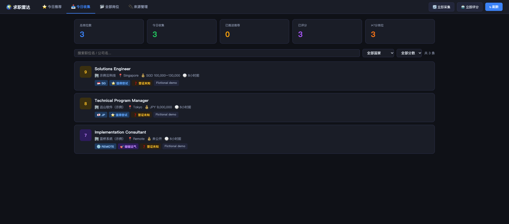

# 求人レーダー

**言語:** [简体中文](README.md) · [English](README.en.md) · 日本語

公開求人を収集し、職種、地域、ビザ、給与の設定に応じて絞り込み、必要に応じて OpenRouter で適合度を分析します。画面は初期設定でローカルホストからのみ利用できます。

## デモの起動

Python 3.11 以上が必要です。`pip install -r requirements.txt`、`python scripts/seed_demo.py`、`python api/app.py` の順に実行し、`http://127.0.0.1:8077` を開いてください。候補者「林知遥」と三件の求人はすべて架空です。デモは求人サイト、AI モデル、Feishu に接続しません。

## 自分の条件を設定する

`.env.example` を `.env` にコピーします。`config/profile.example.json` を `config/profile.json` にコピーして編集し、`JOB_RADAR_PROFILE=config/profile.json` を設定します。`config/sources.yaml` でキーワード、給与条件、ソースを変更します。単発収集は `python scripts/collect_once.py`、評価・分析・任意の配信は `python run_full.py`、定期実行は `python main.py` です。AI には `OPENROUTER_API_KEY`、Feishu 配信には `FEISHU_WEBHOOK_JOBS` が必要です。配信を有効にする前に `DRY_RUN` を確認してください。

LinkedIn のゲストページ収集は初期設定で無効です。ページ変更によって動かなくなる場合があります。各サイトの利用条件と頻度制限を守り、ビザと給与は雇用主の元ページで確認してください。公開版に個人プロフィール、データベース、認証情報は含みません。MIT License。

## 言語

画面右下の選択メニューで中国語・英語・日本語のナビゲーション、フィルター、主な状態表示を切り替えられます。外部のタイトル、原文、診断の詳細は元の言語のまま表示します。
