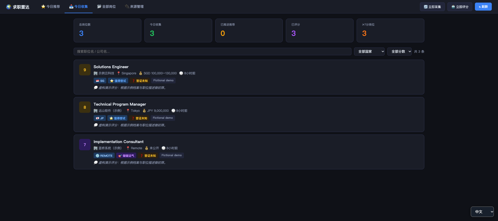
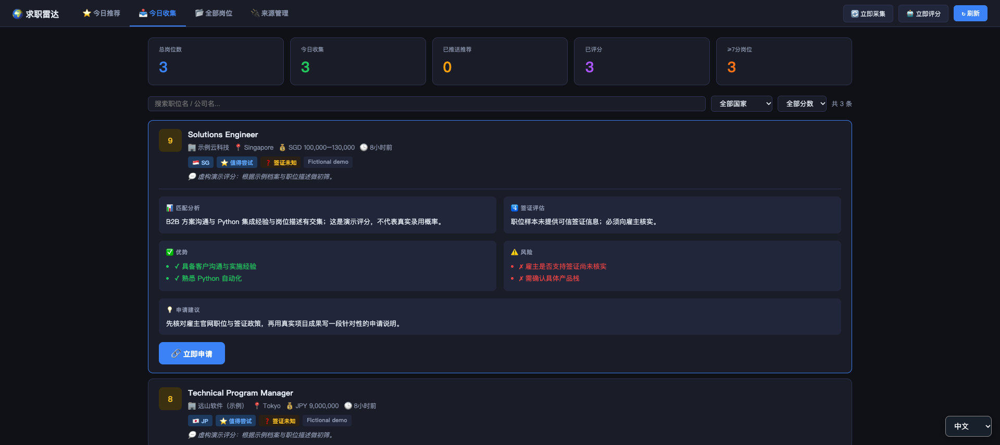
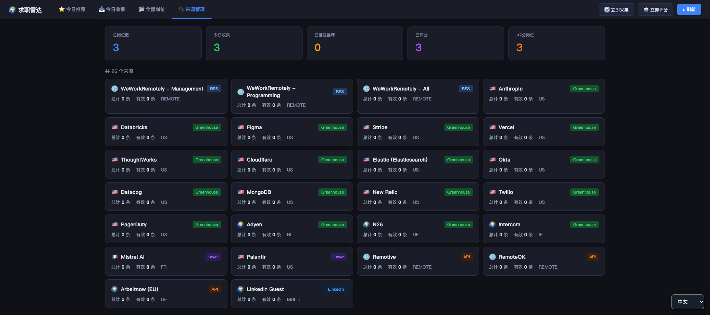

**语言 / Language / 言語:** [简体中文](README.md) · [English](README.en.md) · [日本語](README.ja.md)

# Job Radar / 求职雷达

**少刷重复的招聘页，把时间留给值得认真申请的职位。** 求职雷达把多个公开来源的岗位放在同一处，按自己的地区、职种、薪资与签证需求做初筛，再把“匹配点、未知项、下一步核实什么”放到同一张职位卡里。

| 过去要手动做的事 | 现在能集中查看 |
|---|---|
| 在多家招聘网站反复搜同一类岗位 | 一个职位列表、来源与采集时间 |
| 忘记为什么收藏或放弃某个岗位 | 可配置偏好与匹配理由 |
| 只看分数，忽略签证或薪资缺口 | 单独列出优势、风险与待核实问题 |
| 想快速看效果又不想提供真实简历 | 虚构求职者和三条虚构职位的一键本地演示 |

### 看一条岗位如何变成申请决策

演示中的求职者“林知遥”、公司、职位、分数与分析**全部虚构**，不会访问招聘网站、模型或飞书。

**1. 同一页查看职位、来源、地区、薪资与优先级。**

**2. 点开职位，看到匹配理由、签证未知项和下一步建议。** 演示分析是手工编写的样本，不是模型真实输出。

**3. 来源列表说明支持哪些入口；图中的零计数表示演示没有访问外部平台。**

## 五分钟本地演示

需要 Python 3.11+。执行 `pip install -r requirements.txt`、`python scripts/seed_demo.py`、`python api/app.py`，打开 `http://127.0.0.1:8077`。重复运行种子脚本会更新这三条演示职位。

## 用自己的偏好

复制 `.env.example` 为 `.env`；将 `config/profile.example.json` 复制为 `config/profile.json` 并填写自己的资料，设置 `JOB_RADAR_PROFILE=config/profile.json`。在 `config/sources.yaml` 修改岗位关键词、薪资门槛和来源。个人档案及本地数据库被 Git 忽略。

`python scripts/collect_once.py` 手动采集一次；`python run_full.py` 做评分、分析和可选推送；`python main.py` 启动定时调度。AI 需要 `OPENROUTER_API_KEY`，飞书推送需要 `FEISHU_WEBHOOK_JOBS`。默认 `DRY_RUN=true`，不会发送。

## 数据与判断边界

包含 RSS、Greenhouse、Lever、Remotive、Remote OK、Arbeitnow 和 LinkedIn 访客页面采集器。LinkedIn 默认关闭，显式设置 `ENABLE_LINKEDIN=true` 才启用；页面结构可能变化，使用时应遵守各站条款。模型对签证与薪资的判断只是提示，申请前必须回到雇主原始职位页核实。网页默认仅绑定 `127.0.0.1`。

## 语言

网页右下角可切换中文、English、日本語的主导航、筛选与常见状态。职位标题、公司名称和原始描述保留来源语言。

MIT License。本项目不隶属于任何招聘平台。
